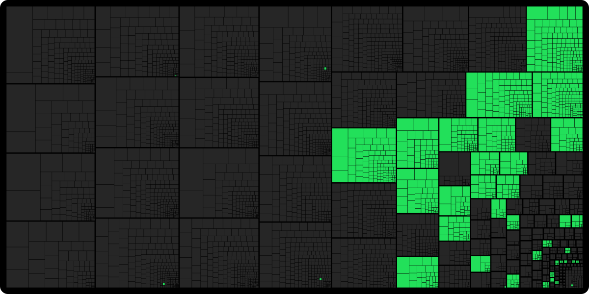

<h1 align="left"></h1>


A work-in-progress decompilation of Danganronpa: Trigger Happy Havoc.

This repository does **not** contain any game assets or machine code. An existing copy of the game is required.

The short-term goal is not to FULLY finish this decomp, its mostly here to understand how danganronpa ticks

Long-term i would like to finish this.

Progress website: **https://pucas01.github.io/DISTRUST/**

<p align="left">
  <a href="https://pucas01.github.io/DISTRUST/"></a>
</p>

Supported versions:

- `DR1_us.exe`: Steam release, English (SHA-1 `e7881c959012c2d565070218b7f6c0d4795f21af`)

Dependencies
============

Windows
--------

- Install [Python](https://www.python.org/downloads/) and add it to `%PATH%`.
- Download [ninja](https://github.com/ninja-build/ninja/releases) and add it to `%PATH%`.
  - Quick install via pip: `pip install ninja`
- Install [7-Zip](https://www.7-zip.org/) and add it to `%PATH%`.
  - Quick install: `winget install 7zip.7zip`

Linux
------

- Install [ninja](https://github.com/ninja-build/ninja/wiki/Pre-built-Ninja-packages), [CMake](https://cmake.org/download/), [7-Zip](https://www.7-zip.org/) (`p7zip-full` on Debian and Ubuntu, `7zip` on Arch), Python 3 and a C++ compiler (GCC or Clang).

macOS
------

Not supported as of now.

Building
========

- Clone the repository with its submodules:

  ```sh
  git clone --recurse-submodules <repository url>
  ```

- Copy your game's `DR1_us.exe` to `orig/`.
- Configure:

  ```sh
  python3 configure.py
  ```

  The first run downloads the Visual Studio 2012 compiler files (about 3 GB) and builds wibo on Linux. See [Toolchain](docs/toolchain.md).

- Build:

  ```sh
  ninja
  ```

  This compiles every file that contains a rewritten function and checks each one against the original. Run `ninja report` for a summary, or `VERBOSE=1 ninja report` to also print the bytes of any mismatch. To compile the stub files as well, run `ninja all`.

Diffing
=======

Once the initial build succeeds, an `objdiff.json` should exist in the project root.

Download the latest release from [encounter/objdiff](https://github.com/encounter/objdiff). Under project settings, set `Project directory`. The configuration should be loaded automatically.

Select an object from the left sidebar to begin diffing. Changes to the project will rebuild automatically: changes to source files, headers or anything in `config/`.

To get a progress report from the command line, pass the relocation option so that wrong globals and call targets count against a match:

```sh
objdiff-cli report generate -c functionRelocDiffs=name_address -o build/report.json
```

Documentation
=============

- [Getting Started](docs/getting_started.md): project layout and how to rewrite a function.
- [Toolchain](docs/toolchain.md): the compiler, its flags, and wibo.

Credits
=======

Thanks to [decompals](https://github.com/decompals/wibo) for wibo and [encounter](https://github.com/encounter/objdiff) for objdiff.

Danganronpa belongs to Spike Chunsoft.
